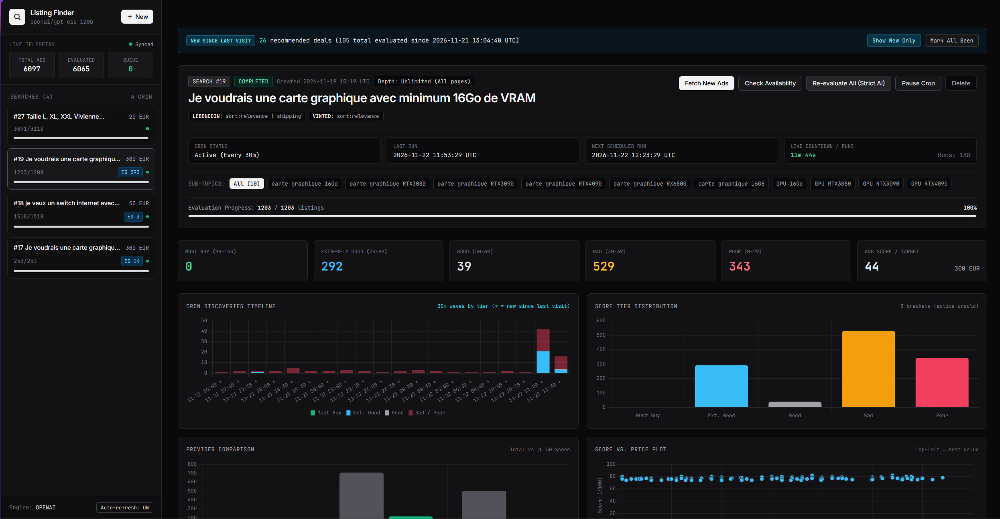
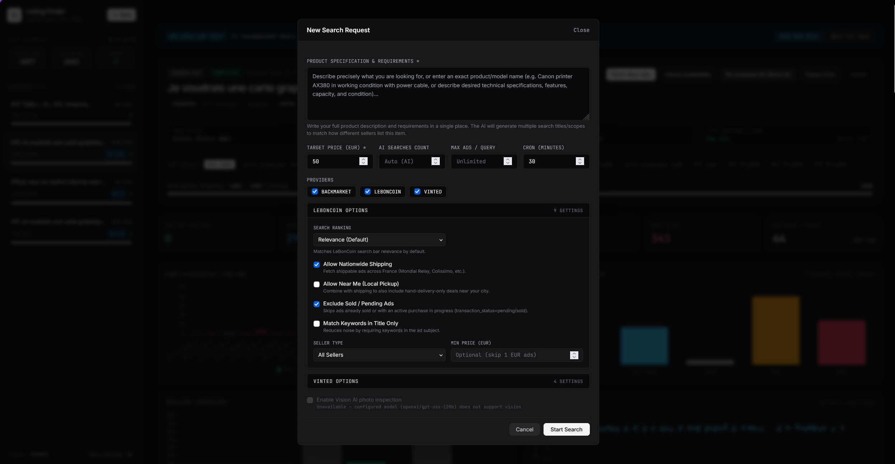
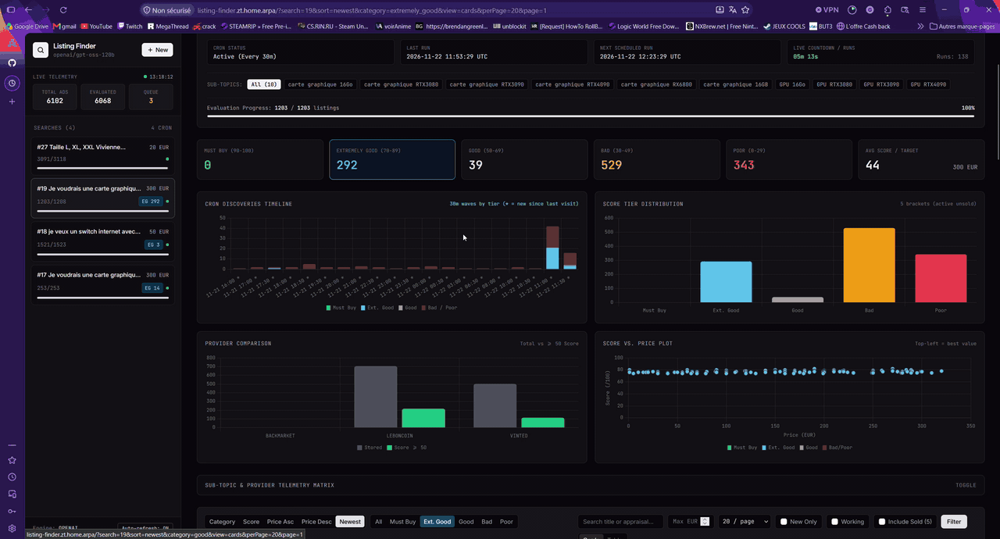

# Listing Finder

**Listing Finder** is a self-hosted AI deal radar for second-hand and refurbished marketplaces (**LeBonCoin**, **Vinted**, **BackMarket**).

Describe **any product** you are looking for in plain language—from an exact model name to a multi-sentence technical specification—set your target price in EUR, and Listing Finder continuously searches the marketplaces, verifies technical specifications, scores every ad from `0` to `100`, and highlights the best deals.



---

## What It Does

### 1. Search for Any Product in Plain Language

Click **+ New** to describe what you want and set your target budget. The AI automatically generates targeted search queries and crawls the selected marketplaces on a recurring schedule (every 30 minutes by default).

- **Works for any category**: Electronics, computer hardware, networking gear, photography equipment, clothing, tools, bicycles, or furniture.
- **Per-marketplace filters**: Configure nationwide parcel shipping, local pickup around your city + kilometer radius (or both combined), seller type, minimum condition, and minimum price.



### 2. Automatic AI Deal Scoring & Spec Verification

Instead of dumping noisy search results, Listing Finder evaluates each ad through a two-stage AI pipeline before recommending it:

1. **Filters out noise first**: Automatically rejects spare parts, cables, empty boxes, and unrelated product categories before scraping full ad pages.
2. **Reads the full ad & verifies datasheets**: Scrapes the seller's complete description, checks whether the item is already sold/reserved, and looks up official model specifications via a self-hosted **SearXNG** instance when an ad mentions a model number.
3. **Scores and classifies every deal (`0–100`)**: Evaluates specification relevance, price vs. target budget, working condition (filtering out broken / *"HS / pour pièces"* items), and estimated age into 5 tiers:
   - **MUST BUY (`90–100`)** — Exact specification match, confirmed functional, priced at or well below your budget.
   - **EXTREMELY GOOD (`70–89`)** — Matches all key requirements, functional, great price around or below budget.
   - **GOOD (`50–69`)** — Matches main product and specs at a fair price.
   - **BAD (`30–49`)** — Overpriced, worn condition, or missing a secondary spec.
   - **POOR (`0–29`)** — Accessory/wrong product, defective, or contradicts mandatory requirements (hidden by default).

### 3. Browse, Filter, and Track Deals Live

The dashboard updates in real time as background workers discover and evaluate listings. Track newly discovered ads since your last visit, compare price vs. score on interactive charts, re-check whether top deals are still available, and open the original marketplace ad in one click.



---

## Quick Start

### Prerequisites

- **Docker** and **Docker Compose v2**
- Either a **local [Ollama](https://ollama.com) server** or an **OpenAI-compatible API key** (e.g. Groq, OpenAI, vLLM)

### 1. Clone and Configure

```bash
git clone <your-repository-url> listing-finder
cd listing-finder
cp .env .env.local
```

Edit `.env.local` to choose your AI backend:

**Option A — Local AI with Ollama (Default):**

```dotenv
AI_PROVIDER=ollama
AI_BASE_URL=http://host.docker.internal:11434
AI_MODEL=lfm2.5:8b
```

**Option B — OpenAI-Compatible API (e.g. Groq):**

```dotenv
AI_PROVIDER=openai
AI_BASE_URL=https://api.groq.com/openai/v1
AI_API_KEY=gsk_your_api_key_here
AI_MODEL=openai/gpt-oss-120b
AI_VISION_ENABLED=false
AI_MIN_REQUEST_INTERVAL_MS=9000
```

### 2. Start the Stack

```bash
docker compose up -d --build
```

This starts the **FrankenPHP** web server (and runs database migrations automatically), the background **Symfony Messenger/Scheduler worker**, **PostgreSQL 16**, and **SearXNG**.

### 3. Open the Dashboard

Visit **[https://localhost](https://localhost)** (or `http://localhost`) in your browser.

---

## Documentation

Detailed guides are available in the [`docs/`](docs/) directory:

- **[Installation & Deployment Guide](docs/installation.md)** — Full setup instructions, local Ollama vs. cloud API configuration, environment variables reference, production Docker Compose, and Kubernetes (`k3s` + Traefik) deployment.
- **[User Guide & CLI Reference](docs/usage.md)** — Writing product specifications, LeBonCoin & Vinted options, dashboard analytics, recurring cron monitoring, availability checks, and Symfony CLI commands.
- **[AI Pipeline & Architecture](docs/architecture.md)** — How the multi-stage AI pipeline works (topic expansion, pre-scrape gatekeeper, SearXNG datasheet RAG, strict calibration guardrails, anti-bot pacing) and local GPU VRAM sizing recommendations.
