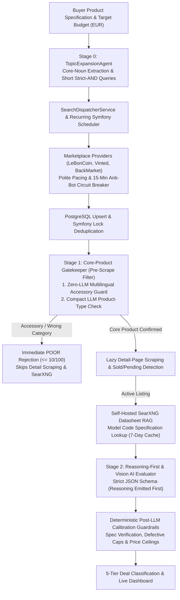

# AI Pipeline & Architecture

Listing Finder is built on **Symfony 8.1**, **PHP 8.5**, **FrankenPHP**, **PostgreSQL 16**, **Symfony Messenger & Scheduler**, **Symfony Lock**, and **SearXNG**. It is 100% domain-agnostic—no product-specific or category-specific keywords are hardcoded into the pipeline.

---

## 1. Multi-Stage Autonomous Pipeline

Rather than sending raw marketplace pages into a single monolithic prompt, Listing Finder processes listings through specialized stages to maximize accuracy and minimize wasted HTTP and LLM calls:

### Stage 0: Core-Noun Anchored Query Expansion (`TopicExpansionAgent`)

Marketplaces like LeBonCoin and Vinted use strict-AND keyword matching where overly long queries return zero ads and bare technical tokens (like `"16Go"` or `"SFP+"` alone) flood results with spare parts.

- `TopicExpansionAgent` extracts the buyer's `core_product_noun` and direct synonyms first, then generates concise 2–3 word search queries where every query is anchored on the core product noun.
- Exact alphanumeric model codes from the buyer's prompt are preserved.

### Stage 1: Pre-Scrape Product-Type Gatekeeper (`ListingEvaluatorAgent::checkCoreProductGatekeeper`)

Runs **before** fetching individual ad detail pages or querying SearXNG:

1. **Zero-LLM Accessory Guard**: Immediately rejects standalone accessories, cables, adapters, chargers, cases, empty boxes, optical transceivers, mounting brackets, and waterblocks/coolers unless the buyer explicitly asked for that item.
2. **Compact LLM Product-Type Check**: Compares `buyer_wants_item_type` vs. `listing_sells_item_type`.
3. **Fast Rejection**: Any wrong product category or spare part is immediately scored `<= 10/100 (POOR)` without making extra marketplace HTTP requests or consuming Stage-2 tokens.

### Lazy Detail-Page Enrichment & SearXNG Datasheet RAG

Listings that pass Stage 1 are enriched before final scoring:

- **Detail-Page Scraping (`fetchListingDetails()`)**: Extracts the seller's full description, brand, condition, and structured attributes from the ad page while checking for HTTP `404`/`410` or sold/pending transaction flags.
- **SearXNG Datasheet Lookup (`SearxngProductSpecService`)**: When a listing title contains a specific model code (e.g. `RTX 3080`, `CRS305-1G-4S+IN`, `AX380`), Listing Finder queries the internal SearXNG JSON API (`bing` + `duckduckgo`, cached for 7 days) and injects verified specifications into the Stage-2 prompt.

### Stage 2: Reasoning-First Appraisal & Calibration Guardrails (`ListingEvaluatorAgent::evaluate`)

- **Reasoning-First JSON Schema**: `ConfigurableLlmClient` enforces a strict JSON Schema where `reasoning` is emitted before booleans and numeric sub-scores, ensuring step-by-step evidence verification.
- **Optional Vision AI**: When `LlmClientInterface::supportsVision()` is true and Vision AI is enabled for the search, listing thumbnails are inspected for physical damage, missing parts, or mismatched model labels.
- **Deterministic Post-LLM Guardrails (`enforceStrictCalibration`)**:
  - Wrong product type or accessory only: capped at `<= 10/100 (POOR)`.
  - Defective, broken, or *"HS / pour pièces"*: capped at `<= 15/100 (POOR)`.
  - Contradicted mandatory spec or 2+ unverified mandatory specs: capped at `<= 29/100 (POOR)`.
  - 1 unverified mandatory spec: capped at `<= 45/100 (BAD)`.

---

## 2. Anti-Rate-Limit Pacing & Circuit Breaker (`ProviderHealthService`)

To prevent IP blocks from marketplace anti-bot protections (such as DataDome on LeBonCoin):

- **Polite Outbound Pacing**: Enforces minimum delays between requests (`2500ms` for LeBonCoin, `1000ms` for Vinted, `2000ms` for SearXNG).
- **15-Minute Cooldown Circuit Breaker**: Upon receiving HTTP `403` or `429`, `ProviderHealthService` pauses all requests to that provider for 15 minutes and displays an active cooldown banner in the dashboard.
- **Single-Replica Worker**: Production deployments keep the background worker at `1` replica to avoid parallel IP bursts.

---

## 3. Local AI Execution & GPU VRAM Sizing

A multi-page search across 6–8 sub-topics typically discovers **1,000 to 1,500 unique listings**. Running a local model via **Ollama** (`AI_MIN_REQUEST_INTERVAL_MS=0`) avoids cloud free-tier rate limits (`30 RPM` / `8,000 TPM`) and evaluates large waves 15x–30x faster at zero token cost.

| Hardware Tier | Available VRAM | Recommended Ollama Models | Context (`AI_NUM_CTX`) | Vision AI | Fit |
| :--- | :--- | :--- | :--- | :--- | :--- |
| **Entry Local GPU** | `8 – 12 GB` | `lfm2.5:8b`, `qwen2.5:7b`, `llama3.1:8b` (`Q4_K_M`) | `8192` | Optional | Fast local text & datasheet appraisal with zero rate limits. |
| **Mid-Range GPU** | `16 GB` | `gemma3:12b`, `qwen2.5:14b`, `qwen2.5-vl:7b`, `llama3.2-vision:11b` | `16384` | Enabled (`auto`) | Stronger multi-requirement reasoning and live Vision AI photo inspection. |
| **Workstation GPU** | `24 – 32 GB+` | `qwen2.5-vl:32b`, `gemma3:27b`, `qwen2.5:32b` | `32768` | Enabled | Maximum datasheet verification accuracy and high-res multimodal inspection. |
