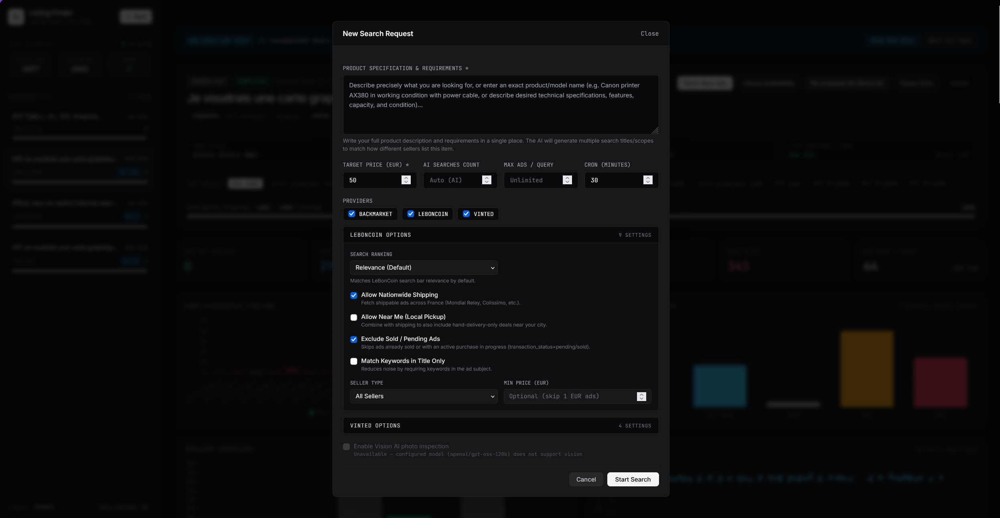
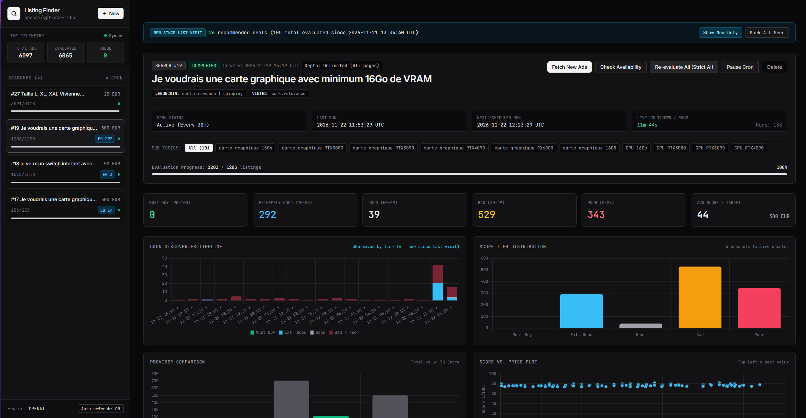

# User Guide & CLI Reference

This guide explains how to create and tune product searches, filter and manage deals in the web dashboard, and automate tasks from the command line.

---

## 1. Creating a Search Request

Click **+ New** in the top-left sidebar of the dashboard to open the **New Search Request** modal.



### Writing Your Product Specification

The **Product Specification & Requirements** field is used both to generate marketplace search queries and to grade every listing. You can write in any language (French, English, etc.) using either style:

- **Exact Product or Model**:
  - `"Canon printer AX380 in working condition with power cable"`
- **Multi-Sentence Technical Requirements**:
  - `"Je voudrais une carte graphique avec minimum 16Go de VRAM"`
  - `"Managed network switch with at least 8 Gigabit RJ45 ports and 2 SFP+ 10GbE cages; if PoE+ is included then 8 ports is fine, otherwise 16 ports minimum."`

> **Tip**: You can include conditional branches (`"if X then Y, otherwise Z"` / `"si X alors Y, sinon Z"`). The AI evaluator checks whether a listing satisfies either valid branch without penalizing specs from the unused branch.

### Core Search Parameters

- **Target Price (EUR)**: Your ideal budget. Marketplaces are queried up to `1.5x` this price so slightly above-budget listings with high specs are still evaluated and scored against your target.
- **AI Searches Count**: Leave blank (`Auto (AI)`) to let the AI generate `5–8` diverse search queries, or enter `1–15` to force an exact query count.
- **Max Ads / Query**: Leave blank (`Unlimited`) to crawl across all available result pages per query (up to `LISTING_PROVIDER_MAX_UNLIMITED_PAGES`), or enter a cap such as `25` or `50`.
- **Cron (Minutes)**: How often the background worker re-checks marketplaces for newly posted ads (default: `30` minutes).

---

## 2. Marketplace Provider Options

Selecting **LEBONCOIN**, **VINTED**, or **BACKMARKET** reveals each marketplace's filter settings.

### LeBonCoin Options

| Setting | Default | Description |
| :--- | :--- | :--- |
| **Search Ranking** (`sort`) | `Relevance` | Native LeBonCoin relevance (`relevance`), `Newest First` (`time`), or `Price: Low to High` (`price_asc`). |
| **Allow Nationwide Shipping** (`allow_shipping`) | Checked | Includes ads offering parcel shipping across France (`mondial_relay`, `colissimo`, `chronopost`, `shop2shop`, `relais_colis`). |
| **Allow Near Me (Local Pickup)** (`allow_near_me`) | Unchecked | Enables local search around a French city or postal code. |
| **Location** (`location`) | *(empty)* | French city or postal code (e.g. `Lyon`, `Vannes`, `75001`), geocoded via `api-adresse.data.gouv.fr`. |
| **Radius (km)** (`radius_km`) | `30` | Search radius (`5–200` km) around the selected city. |
| **Exclude Sold / Pending Ads** (`exclude_sold`) | Checked | Filters out ads that are already sold, reserved, or have a pending transaction. |
| **Match Keywords in Title Only** (`search_in_title`) | Unchecked | Requires search keywords to appear in the listing title (`search_in=subject`). |
| **Seller Type** (`owner_type`) | `All Sellers` | `All Sellers` (`all`), `Private Individuals Only` (`private`), or `Professionals Only` (`pro`). |
| **Min Price (EUR)** (`min_price`) | *(empty)* | Skips symbolic 1 EUR listings or cheap accessories below this price. |

> **Nationwide Shipping + Local Pickup Union**: When both **Allow Nationwide Shipping** and **Allow Near Me** are checked, Listing Finder runs both a nationwide shippable search and a local radius search for every sub-topic and merges their deduplicated results.

### Vinted Options

| Setting | Default | Description |
| :--- | :--- | :--- |
| **Search Ranking** (`sort`) | `Relevance` | `Relevance` (`relevance`), `Newest First` (`newest_first`), or `Price: Low to High` (`price_low_to_high`). |
| **Minimum Condition** (`min_condition`) | `All Conditions` | `All Conditions` (`all`), `Good or Better` (`good_plus`), `Very Good or Better` (`very_good_plus`), or `New Only` (`new_only`). |
| **Exclude Sold / Reserved Ads** (`exclude_sold`) | Checked | Skips closed, reserved, or unbuyable items. |
| **Min Price (EUR)** (`min_price`) | *(empty)* | Filters out listings priced below this floor. |

---

## 3. Understanding Deal Scores & Tiers

Every evaluated listing receives 4 sub-scores (`0–100`) and an overall composite score:

- **Relevance (`45%`)**: Match against your required product type and mandatory specifications.
- **Price (`25%`)**: Listing price compared to your target budget.
- **Condition (`20%`)**: Functional status (`Functional` vs. `Defective / HS`) and physical wear.
- **Age (`10%`)**: Estimated product age or hardware generation.

| Tier | Score | Meaning |
| :--- | :--- | :--- |
| **MUST BUY** | `90 – 100` | Exact product & specification match, functional, priced at or well below target budget. |
| **EXTREMELY GOOD** | `70 – 89` | Matches all key specifications, functional, fair price around or below target budget. |
| **GOOD** | `50 – 69` | Matches main product and most specs with an acceptable price or minor cosmetic wear. |
| **BAD** | `30 – 49` | Overpriced relative to target, worn condition, or 1 unverified mandatory specification. |
| **POOR** | `0 – 29` | Wrong product/accessory (`0–10`), defective/HS (`0–15`), or missing mandatory specs (`10–29`). |

---

## 4. Dashboard Analytics, Filtering & Deal Management



### Live Charts & Telemetry

- **5-Tier KPI Cards**: Click any tier card (`MUST BUY`, `EXTREMELY GOOD`, `GOOD`, `BAD`, `POOR`) to filter the listings below to that tier.
- **2x2 Visual Analytics Grid**:
  - **Cron Discoveries Timeline**: Stacked 30-minute discovery waves color-coded by deal tier (waves marked with `*` occurred since your last visit).
  - **Score Tier Distribution**: Volume of active unsold ads across the 5 tiers.
  - **Provider Comparison**: Total stored listings vs. recommended deals (`Score >= 50`) per marketplace.
  - **Score vs. Price Plot**: Scatter plot of all evaluated listings (top-left points = highest score at the lowest price).
- **Sub-Topic & Provider Telemetry Matrix**: Expandable table showing which AI-generated search queries and marketplaces yield the highest-scoring deals.

### Sticky Filter Toolbar

- **Sort Modes**: `Category` (grouped by tier), `Score` (`100` down to `0`), `Price Asc`, `Price Desc`, or `Newest` (most recently evaluated first).
- **Quick Toggles**:
  - `New Only`: Shows only ads discovered since you last clicked **Mark All Seen**.
  - `Working`: Shows only confirmed functional items.
  - `Include Poor`: Reveals rejected `POOR (0–29)` listings (hidden by default in `All` view).
  - `Include Sold (N)`: Reveals ads flagged as sold or deleted (hidden by default).
- **View Mode**: Switch between detailed **Cards** view and compact **Table** view.

### Search Lifecycle Actions

In the top-right corner of the active search panel:

- **Fetch New Ads**: Triggers an immediate incremental crawl across all sub-topics and providers.
- **Check Availability**: Re-checks the detail pages of your top unsold recommended deals (`Score >= 50`, up to 50 ads per run) using polite rate-limit pacing and marks sold or deleted ads as `SOLD`.
- **Re-evaluate All (Strict AI)**: Clears existing evaluations and re-runs the AI evaluator across all stored listings (useful after changing `AI_MODEL`).
- **Pause Cron / Enable Cron**: Toggles recurring background monitoring for the search.
- **Delete**: Permanently deletes the search request and its listings.

---

## 5. Command-Line Interface (CLI) Reference

When running with Docker Compose, prefix commands with `docker compose exec php`:

### Start a Search (`app:search:start`)

```bash
# Basic search with a 50 EUR target budget
docker compose exec php php bin/console app:search:start \
  --price=50 \
  "Canon printer AX380 in working condition with power cable"

# Unlimited multi-page crawl with LeBonCoin shipping + local pickup union and Vinted condition filter
docker compose exec php php bin/console app:search:start \
  --price=300 \
  --unlimited \
  --interval=30 \
  --providers=leboncoin,vinted \
  -o leboncoin.sort=relevance \
  -o leboncoin.allow_shipping=true \
  -o leboncoin.allow_near_me=true \
  -o leboncoin.location=Lyon \
  -o leboncoin.radius_km=30 \
  -o leboncoin.exclude_sold=true \
  -o leboncoin.min_price=80 \
  -o vinted.min_condition=very_good_plus \
  "Je voudrais une carte graphique avec minimum 16Go de VRAM"
```

### View Evaluated Deals (`app:search:results`)

```bash
# Show recommended deals (score >= 50) for the latest search
docker compose exec php php bin/console app:search:results

# Show deals for Search #19 sorted by score
docker compose exec php php bin/console app:search:results 19 --by-score

# Filter to a single tier (must_buy | extremely_good | good | bad | poor) or include all tiers
docker compose exec php php bin/console app:search:results 19 extremely_good
docker compose exec php php bin/console app:search:results 19 --by-category --all

# Export results as JSON
docker compose exec php php bin/console app:search:results 19 --by-score --json
```

### Run Cron Sweeps & Manage Searches (`app:cron:run`, `app:search:stop`)

```bash
# Run due cron tasks (or --force to run all active cron tasks immediately)
docker compose exec php php bin/console app:cron:run
docker compose exec php php bin/console app:cron:run --force

# List active cron tasks, stop a schedule, or purge a search completely
docker compose exec php php bin/console app:search:stop --list
docker compose exec php php bin/console app:search:stop 19
docker compose exec php php bin/console app:search:stop 19 --purge
```

### Benchmark the AI Pipeline (`app:ai:benchmark`)

```bash
docker compose exec php php bin/console app:ai:benchmark
docker compose exec php php bin/console app:ai:benchmark --json
```
